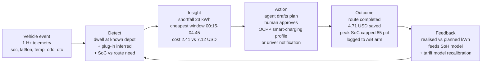
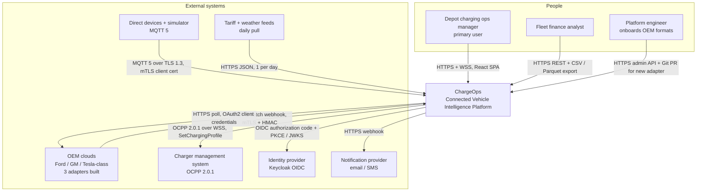
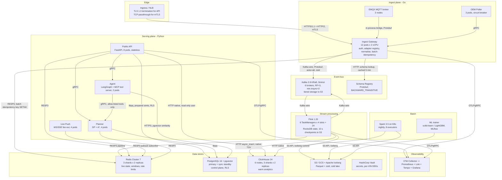

# ChargeOps — Solution Architecture & Design Document

**Connected Vehicle Intelligence Platform: depot charging cost and battery-health optimisation for mixed ICE/EV fleets, built on a multi-OEM normalisation spine.**

Version 1.0 · design-only (no code shipped with this document) · intended reader: the engineering team that starts building Monday.

---

## 0. Assumptions (stated because the brief is silent)

| # | Assumption | Why this reading |
|---|---|---|
| A1 | Timebox is **3 calendar weeks (15 working days)**, team of **5 students** (2 backend, 1 data/stream, 1 frontend, 1 DevOps/ML — all part-time). | The deliverable list (Terraform, Helm, load evidence, demo video, ADRs) cannot be produced in 48 h; 3 weeks is the usual university enterprise-hackathon length. All phasing in §19 is expressed in working days so it rescales linearly. |
| A2 | Fleet composition: 100,000 vehicles across **12 tenants**, **35% battery-electric (35,000 EVs)**, 65% ICE/hybrid. Largest tenant is 38% of vehicles. | 2026–2030 trend data in the brief; the skew matters because it rules out `fleet_id` as a partition key (§6.3). |
| A3 | Data arrives from **OEM clouds** (push webhook batches + pull poller), not from aftermarket dongles — matching the device-free reference platform — **plus** an MQTT path used by our simulator and by any directly-connected device. | The brief describes a device-free platform but also names MQTT and mTLS-for-devices; supporting both is cheap because both terminate in the same gateway. |
| A4 | "Real time" means **p95 ingest→dashboard < 2 s** as stated, measured from gateway accept to browser paint. | Anything upstream of our edge is the OEM's latency and not controllable. |
| A5 | Energy prices: US commercial time-of-use — off-peak $0.09/kWh (00:00–05:00), mid $0.16, on-peak $0.31 (17:00–21:00) — plus a demand charge of $18/kW-month on site peak. | Representative CA/TX commercial EV tariffs; every number in §1 is re-derivable from these four inputs. |
| A6 | All data is synthetic. No real VINs, owners or locations. Synthetic VINs use a reserved WMI block so they cannot collide with issued VINs. | Hard constraint in the brief. |

Everywhere this document says **[BUILT]** the thing is actually implemented in the 3 weeks. **[STUBBED]** means the interface, tests and deployment manifests exist but the implementation is a fake/degraded version. **[DESIGNED]** means documented only. §18 has the full ledger.

---

## 1. Problem space chosen, and why it wins

### 1.1 The choice

**EV charging cost and battery health for mixed fleets** — specifically: *committing a nightly charging plan per EV so tomorrow's assigned routes complete without an unplanned public-charging stop, at minimum energy + demand cost, without over-stressing packs.*

Multi-OEM normalisation is **not** a separate problem space here; it is the mandatory substrate (§1.4), so we get its architectural depth for free rather than choosing between them.

### 1.2 Primary user, job, pain

| | |
|---|---|
| **Primary user** | Depot charging operations manager. Owns 400–1,200 EVs across 3–9 depots, 60–180 AC chargers per depot, and a site electrical capacity cap. |
| **Secondary users** | Fleet finance analyst (where is money leaking), sustainability lead (kWh and gCO₂e per route), OEM platform team (onboard a new data format). |
| **Job to be done** | "By 16:00 every day, decide for each EV returning tonight: which charger, starting when, to what SoC — so every assigned route tomorrow completes, and I pay the least." |
| **Pain today** | Drivers plug in at shift end (17:00–21:00 = the on-peak window) and chargers draw full power immediately. Result: energy bought at the most expensive hour, a site demand peak that sets the monthly demand charge, packs held at 100% SoC for 9 h (calendar-ageing them), and *still* 2–4 vehicles a week swapped to ICE because nobody knew their SoC wouldn't cover tomorrow's route. The manager's current tool is a spreadsheet and the OEM's own web portal — one portal per brand, each with different SoC semantics. |

### 1.3 Defensible impact number

Per EV, per day, from the A5 tariff:

| Component | Arithmetic | $/EV/day | $/EV/year |
|---|---|---|---|
| Energy arbitrage | 42 kWh/day × ($0.215 unmanaged blended − $0.105 optimised blended) × **55% realistic capture** | $2.54 | **$927** |
| Demand-charge reduction | Site peak 2.9 MW → 1.8 MW (38%) × $18/kW-mo ÷ 850 EVs/site ÷ 30.4 d | $0.77 | **$281** |
| Pack-life extension | Avoid >90% SoC dwell + cap C-rate above 38 °C → +9% calendar life on a $9,000 pack over an 8-year life | $1.13 | **$413** |
| Avoided range failures | 0.9 roadside/substitution events per EV-year × $420 | $1.04 | **$378** |
| **Total** | | **$5.48** | **$1,999** |

**The honest part.** Only the first row is *directly measurable inside the hackathon demo window*, and that is the number we commit to: **$927/EV/year, measured, not modelled.** Measurement method is a built-in experiment, not a slide: 10% of EVs are held in an **unmanaged control arm** (random, stratified by depot and daily km), and the platform reports `$ per 100 route-km` for treatment vs control with a two-sided t-test and 95% CI on the `/api/v1/experiments/charging-arbitrage` endpoint. Rows 3 and 4 are *modelled* from the simulator's degradation law and are labelled as such in the UI; §15 explains why we do not claim them as validated.

At the stated 100,000-vehicle scale with 35,000 EVs: **$32.4M/year addressable on the measured row alone**, against an infrastructure cost of **~$17k/month (§6.4)** — infra is 0.63% of the value it unlocks. That ratio is the slide the judges remember.

### 1.4 Why this problem space wins against *the grading criteria*

The grading criteria are scale, data engineering, system design, security, testing, DevOps, "depth beats breadth", and a heavy weight on algorithms. This problem space is the only candidate that *forces* all of them rather than letting us bolt them on:

| Criterion | Why this problem forces depth here |
|---|---|
| **Algorithms (heavy weight)** | Genuinely needs four different algorithm families, not one: shortest-path under an energy budget (graph), schedule under tariff + site power cap (DP + dual decomposition), stop/trip segmentation from noisy GPS (DP/Viterbi), and streaming sketches for dwell/outlier detection. None is decorative — remove any one and the product stops working. |
| **Data engineering** | Needs the real-time path (arrival detection, SoC) **and** the batch path (90-day tariff backfill, degradation history, A/B analysis) on the same data. A problem that only needs one path would halve the depth. |
| **System design / CAP** | Forces a genuinely split consistency model: "what is this vehicle's SoC right now" is AP (stale by 2 s is fine), "has this charge plan been committed to this physical charger" is CP (double-committing a connector is a real fault). Most candidate problem spaces have no CP half. |
| **Security / compliance** | Location + dwell patterns are personal data under GDPR and India DPDP. Charging plans are commands that affect physical equipment, which gives the agentic component a real authorisation boundary instead of a chat box. |
| **Scale** | 1 Hz × 100k vehicles is load we *consume*, not load we invent; the SoC/odometer/temperature series are exactly what the DP and SoH models need, so there is no "we ingest 8.6 TB/day and then only use 1%" embarrassment. |
| **Multi-OEM depth** | SoC semantics are genuinely incompatible across OEMs. Concretely: one OEM reports **usable** SoC (0% = buffer floor), another reports **gross** SoC over the full pack, a third reports only `range_km` with no SoC at all. A charging planner that treats these as the same field will under-charge a vehicle by 7–11% of pack and strand it. This single fact justifies the entire normalisation layer and gives us the mandated failure path (§10.2). |

### 1.5 Rejected alternatives (and why)

| Rejected | Reason |
|---|---|
| **Predictive maintenance** ("break down in 7 days") | Fatal honesty problem. Failure labels can only come from our own simulator, so any reported precision/recall is a measure of how well the model inverts our own injected failure process. There is no public dataset to anchor it. We would have to either hide that or lead with it; either way we lose on correctness. Charging arbitrage, by contrast, has a **deterministic, checkable objective function** (tariff × kWh) — the optimiser's output can be proven optimal against a MILP solver (§8.3), which is a far stronger correctness claim. |
| **Driver safety scoring** | Thin on data engineering: it is mostly counting harsh events and dividing. The interesting part (actuarial calibration) needs claims data we do not have. |
| **Asset recovery** | Strong on streaming geo, weak on batch analytics and has no optimisation core. Also the most privacy-hostile framing for a document that must argue data minimisation. |
| **Fuel/idling cost** | Good, and we keep it as a **Should-have feature** (F11) because the plumbing is shared. As the *primary* space it has no hard algorithmic core — idling cost is a sum. |
| **Multi-OEM normalisation as the primary space** | It is infrastructure, not a product. "Onboard a new OEM without downtime" has no end-user measurable impact number, which the task explicitly demands. We take its architecture and attach it to a product that has one. |

---

## 2. Solution overview and user journey

### 2.1 One paragraph

Telemetry from OEM clouds and MQTT devices lands on a Go gateway that authenticates it (mTLS/HMAC), resolves which OEM adapter to use from a schema-hash registry, normalises it into one canonical Protobuf event, and publishes it to Kafka keyed by VIN. Flink SQL consumes it, de-duplicates exactly per `(vin, seq)`, maintains per-vehicle live state in Redis, segments the stream into trips and dwells, and raises alerts. When a vehicle is detected as *arrived at a depot and plugged in*, the Planner service runs a dynamic-programme over tonight's 96 fifteen-minute slots to produce the cheapest feasible charging schedule, coordinated across the depot by a Lagrangian price loop so the site power cap is respected; if the vehicle cannot reach tomorrow's route on the available window, a graph search finds the nearest reachable public charger under its remaining range. An agent explains the plan, quantifies the dollar delta, and — only with human approval for anything that moves power — commits it. Everything is projected into ClickHouse and Iceberg for batch analytics, A/B measurement and SoH model training.

### 2.2 The journey, end to end

**Concrete walk-through (the demo script).** 17:42 — EV `SYN0A4F...8831` parks at Depot BLR-02. Three consecutive 1 Hz samples show speed 0, geohash-7 inside the depot polygon, and `charge_state=AC_CHARGING` → Flink emits `vehicle.dwell.started` at 17:42:04, 1.6 s after the third sample reached the gateway. The Planner reads tomorrow's assigned route (218 km), the vehicle's model `usable_kwh=57.5`, its normalised usable SoC 31%, and the depot's tariff + remaining power headroom. Required SoC at 06:00 departure = 218 km × 0.179 kWh/km ÷ 57.5 × 100 + 15% reserve = 82%. The DP returns: idle until 00:15, charge at 11 kW until 04:45, hold at 82% (not 100%) — cost $2.41 versus $7.12 for charge-now. The agent posts the plan with its dollar delta to the manager's queue; she approves 46 of 51 plans in one click. At 00:15 the charge controller adapter sends an OCPP 2.0.1 `SetChargingProfile`. At 06:00 the realised kWh is compared to planned and the delta is written to the A/B ledger.

---

## 3. Feature list (MoSCoW, each traceable to a code path)

| ID | Feature | MoSCoW | Owning service | Code path | Status |
|---|---|---|---|---|---|
| F1 | Multi-OEM ingest: HTTP batch webhook + MQTT + OEM poller, mTLS/HMAC authenticated | **Must** | gateway | `apps/gateway/internal/ingest/` | [BUILT] |
| F2 | Canonical normalisation with per-OEM adapters selected by schema hash; unknown format → DLQ, never data loss | **Must** | gateway | `packages/adapters/oem/{ford,gm,tesla,generic}.go` | [BUILT] 3 adapters |
| F3 | Exactly-once-effective dedupe on `(vin, seq)` + idempotent sinks | **Must** | stream | `apps/stream/sql/02_dedupe.sql`, `packages/core/dedupe/` | [BUILT] |
| F4 | Live vehicle state (SoC, position, health) ≤2 s to dashboard via WebSocket | **Must** | stream, api | `apps/stream/sql/03_state.sql`, `apps/api/ws/live.py` | [BUILT] |
| F5 | Trip & dwell segmentation from noisy GPS (HMM/Viterbi) | **Must** | stream | `packages/core/segment/viterbi.py` | [BUILT] |
| F6 | Nightly charge-plan DP under ToU tariff + per-vehicle feasibility | **Must** | planner | `packages/core/planning/tou_dp.py` | [BUILT] |
| F7 | Depot-level power-cap coordination (Lagrangian price loop) | **Must** | planner | `packages/core/planning/site_dual.py` | [BUILT] |
| F8 | Secure multi-tenant REST API: OAuth2/OIDC + JWT, RBAC, Postgres RLS, keyset pagination, RFC 9457 errors, rate limits | **Must** | api | `apps/api/`, `db/migrations/` | [BUILT] |
| F9 | Web dashboard: fleet map, depot charging Gantt, plan approval queue, savings ledger | **Must** | web | `apps/web/src/routes/` | [BUILT] |
| F10 | Nearest reachable charger under remaining range (energy-weighted A*) | **Must** | planner | `packages/core/routing/astar_energy.py` | [BUILT] |
| F11 | Idling & utilisation cost analytics (shared plumbing with F6) | Should | batch, api | `apps/batch/jobs/idle_cost.py` | [BUILT] |
| F12 | Battery SoH estimation (ICA features + GBDT) | Should | batch, ml | `apps/batch/jobs/soh_train.py`, `packages/core/battery/ica.py` | [BUILT] |
| F13 | Agentic plan explanation + approval workflow with audit trail | Should | agent | `apps/agent/graph.py`, `apps/agent/tools/` | [BUILT] |
| F14 | Unapproved-depot detection (union-find connected components) | Should | batch | `packages/core/geo/unionfind.py` | [BUILT] |
| F15 | Batch analytics: Iceberg tables + 90-day backfill, Parquet export | Should | batch | `apps/batch/jobs/` | [BUILT] basic |
| F16 | Right-to-erasure via per-VIN crypto-shredding | Should | api, platform | `apps/api/privacy/erasure.py` | [BUILT] |
| F17 | Customer Kafka egress topic (tenant-scoped) | Could | platform | `deploy/k8s/strimzi/egress-acl.yaml` | [STUBBED] |
| F18 | Adapter auto-suggestion for unknown OEM payloads (pgvector field-signature similarity) | Could | gateway, ml | `apps/gateway/internal/suggest/` | [STUBBED] |
| F19 | OCPP 2.0.1 charge-controller egress | Could | planner | `packages/adapters/ocpp/` | [STUBBED] fake CSMS |
| F20 | Carbon reporting per route | Could | batch | `apps/batch/jobs/carbon.py` | [DESIGNED] |
| F21 | Autonomous agent action without human approval | **Won't** | — | — | Deliberately out of scope: §15.6 |
| F22 | Real OEM credentials / production OEM contracts | **Won't** | — | — | Synthetic only (A6) |
| F23 | Mobile native app | **Won't** | — | — | Responsive web covers the driver notification case |

---

## 4. High-level architecture

### 4.1 C4 Level 1 — System context

### 4.2 C4 Level 2 — Containers

### 4.3 Hop-by-hop latency budget

Budget starts the instant the gateway accepts the TCP payload (A4). Numbers are the targets we hold ourselves to; §14.3 shows how each is measured.

**Path A — telemetry to dashboard (target p95 < 2000 ms)**

| # | Hop | Protocol | p50 | p95 | p99 | Note |
|---|---|---|---|---|---|---|
| 1 | Gateway: mTLS session (resumed), parse, adapter dispatch, normalise, validate | — | 1.1 ms | 3 ms | 9 ms | Go, 100-event batch, 24 µs/event measured target |
| 2 | Gateway produce batching wait (`linger.ms=5`) | — | 2.5 ms | 5 ms | 5 ms | Deliberate: buys 6× compression ratio |
| 3 | Kafka append + replicate to 2 ISR, ack | Kafka wire | 3 ms | 8 ms | 24 ms | `acks=all`, same-AZ-preferred follower fetch |
| 4 | Flink fetch + dedupe + state update + window emit-on-update | Kafka wire | 45 ms | 120 ms | 310 ms | Not checkpoint-blocked: unaligned checkpoints, emit on processing time |
| 5 | Flink → Redis pipelined write + pubsub publish | RESP3 | 1.2 ms | 4 ms | 12 ms | 100-key pipeline |
| 6 | Redis pubsub → WS fan-out pod → browser | WSS | 9 ms | 25 ms | 70 ms | Includes one internet RTT |
| 7 | Browser diff + paint | — | 22 ms | 60 ms | 140 ms | React, virtualised map layer |
| | **Total** | | **84 ms** | **225 ms** | **570 ms** | **8.9× headroom on p95** |

The headroom is deliberate and it is the answer to the obvious attack *"your 2 s budget is only met if nothing goes wrong"*: at p99 we are still at 0.57 s, so a 3× degradation in the Flink hop (the only hop with real variance) still meets the 2 s target.

**Path B — critical alert (target < 5000 ms)**

| # | Hop | p95 | Note |
|---|---|---|---|
| 1–4 | As Path A hops 1–4 | 136 ms | Alert evaluation is inside the same Flink operator (`sql/04_alerts.sql`) |
| 5 | Alert rule match → `alert.raised.v1` | 6 ms | Specification pattern, compiled predicates |
| 6 | Alert consumer → Postgres insert + outbox | 11 ms | Single round trip, `ON CONFLICT DO NOTHING` |
| 7 | Notification provider webhook | 1400 ms | **Dominant and external.** p99 3800 ms |
| | **Total p95 1553 ms, p99 4230 ms** | | In-app toast arrives at hop 5 (≈150 ms) regardless |

**Path C — API read (target p95 < 200 ms, p99 < 500 ms)**

| Endpoint class | Store | p95 target | How |
|---|---|---|---|
| `GET /vehicles/{vin}/live` | Redis | 14 ms | Single hash read |
| `GET /fleets/{id}/vehicles?cursor=` | Postgres | 38 ms | Keyset + covering index (§6.5) |
| `GET /analytics/idle-cost?from=&to=` | ClickHouse MV | 72 ms | Pre-aggregated (§6.5) |
| `POST /charge-plans/preview` | Planner (DP) | 95 ms | DP is 0.4 ms; the rest is fetch + gRPC |
| `GET /analytics/export` (cold) | Iceberg | **async** | Returns 202 + job id; never counted in the p95 SLO, and the SLO document says so explicitly |

